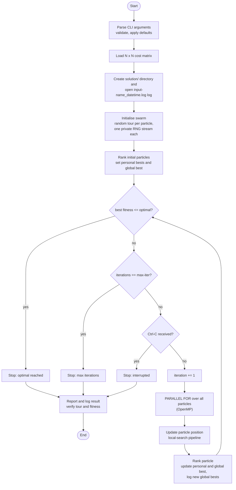
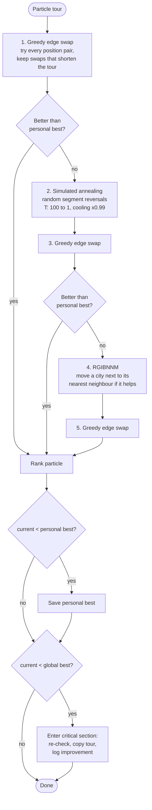

# Hybrid Asymmetric TSP solver using PSO

A multi-threaded (OpenMP) C solver for tour problems given as a full cost matrix
(for example asymmetric TSP instances such as `ftv44`). It evolves a swarm of
candidate tours with a **memetic / hybrid PSO**: every particle is improved each
iteration by a pipeline of local-search operators (greedy edge swap, simulated
annealing, nearest-neighbour insertion), and the swarm keeps track of personal
and global bests.

- Pure C11, no dependencies besides OpenMP and libm
- Particles are updated in parallel, each with its own private RNG stream
- Runs until a target ("optimal") value is reached, for a fixed number of
  iterations, or both (whichever comes first)
- Every run writes a timestamped log and final result to `solution/`

---

## Contents

1. [Quick start](#quick-start)
2. [Command-line reference](#command-line-reference)
3. [Input format](#input-format)
4. [Output format](#output-format)
5. [How the algorithm works](#how-the-algorithm-works)
6. [Build options](#build-options)
7. [Project layout](#project-layout)
8. [Reproducibility and threading](#reproducibility-and-threading)
9. [Exit codes](#exit-codes)
10. [Troubleshooting](#troubleshooting)

---

## Quick start

```bash
make                                                  # builds ./pso

# run until the best known value (1613 for ftv44) is reached
./pso -i ftv44.txt -d 45 --optimal 1613

# run a fixed number of iterations with a bigger swarm and a fixed seed
./pso -i ftv44.txt -d 45 --max-iter 5000 --swarm 100 --seed 42

# stop at whichever comes first
./pso -i ftv44.txt -d 45 -O 1613 -m 20000
```

Follow progress while it runs (new global bests are logged as they are found):

```bash
tail -f solution/ftv44_*.log
```

Press **Ctrl-C** to stop a search at any time; the best tour found so far is
printed and written to the result file.

---

## Command-line reference

```
pso -i FILE -d N (--optimal VALUE | --max-iter N) [options]
```

### Required

| Option | Description |
|---|---|
| `-i`, `--input FILE` | Cost-matrix file (`N x N` whitespace-separated integers) |
| `-d`, `--dim N` | Matrix size / number of cities, integer >= 4 |

### Stop condition (at least one is required)

| Option | Description |
|---|---|
| `-O`, `--optimal VALUE` | Stop once the best tour length is `<= VALUE`. If the value is never reached the run continues forever (until Ctrl-C). |
| `-m`, `--max-iter N` | Stop after `N` iterations (`N >= 1`). |

If both are given, the run stops at whichever condition is met first.
If neither is given the program refuses to start, so a run can never be
accidentally unbounded.

### Optional

| Option | Default | Description |
|---|---|---|
| `-s`, `--swarm N` | `60` | Number of particles |
| `-w`, `--inertia W` | `0.5` | Inertia weight *w* (see note below) |
| `--c1 X` | `2.0` | Cognitive acceleration factor (see note below) |
| `--c2 X` | `2.0` | Social acceleration factor (see note below) |
| `-r`, `--seed N` | `1` | Random seed (unsigned integer) |
| `-h`, `--help` | | Print usage and exit |

> **Note on `w`, `c1`, `c2`:** in the default build the classic PSO velocity
> update is disabled, exactly as in the original code. Particle positions are
> driven only by the local-search operators, so these three values are accepted
> but have no effect. Build with `make VELOCITY=1` to enable the velocity update
> (see [Build options](#build-options)).

Invalid or missing arguments print a specific error message followed by the
full usage text, and exit with status 1.

---

## Input format

A plain text file holding `N x N` integers separated by any whitespace
(spaces and/or newlines). Entry in row `i`, column `j` is the cost of travelling
**from city `i` to city `j`**, so the matrix may be asymmetric.

```
9999   3   5   2
   4 9999   6   7
   1   8 9999   3
   5   2   4 9999
```

- The diagonal is never used, so any value (0, 9999, ...) is fine.
- The file must contain at least `N x N` values. If it holds fewer, the program
  stops with an error; if it holds more, it warns that `--dim` may be wrong and
  ignores the extras.
- Cities are numbered `0 .. N-1`.
- Costs are read as `int`; tour lengths are accumulated as `long`.

---

## Output format

Each run creates one new file in a `solution/` directory in the **current
working directory** (created automatically if missing):

```
solution/<inputFileName>_<YYYY-MM-DD_HH-MM-SS>.log
```

`<inputFileName>` is the input file's base name without its directory and last
extension, so `data/ftv44.txt` becomes `solution/ftv44_2026-10-30_06-11-40.log`.

The file contains the run settings, one line for every new global best, and a
final result block:

```
========================================
Run started at: 2026-10-30 06:11:40
========================================
Input file   : data/ftv44.txt
Output file  : solution/ftv44_2026-10-30_06-11-40.log
Dimension    : 45
Swarm size   : 60
w / c1 / c2  : 0.5 / 2 / 2  (velocity update disabled: unused)
Seed         : 1
Optimal value: 1613
Max iters    : (unlimited)

[2026-10-30 06:11:40] Iteration: 0 	 Fitness: 2497
[2026-10-30 06:11:41] Iteration: 3 	 Fitness: 2104
...

---------------- RESULT ----------------
Finished at  : 2026-10-30 06:12:05
Stop reason  : optimal value reached
Iterations   : 1234
Elapsed (s)  : 24.512
Best fitness : 1613
Best tour    : 0 17 5 ... 3
```

- `Iteration: 0` is the random initial swarm; loop iterations count from 1.
- The log is flushed after every line, so it is always current even if the
  process is killed.
- The same final summary and tour are also printed to the terminal.
- The best tour is a permutation of `0 .. N-1`; the tour is closed, i.e. the
  last city connects back to the first.

---

## How the algorithm works

### Big picture



### Per-particle update (the core logic)

Each particle holds a complete tour. Every iteration it runs this pipeline.
After each stage, if the particle's current tour already beats its own personal
best, the remaining (more expensive) stages are skipped.



### The operators

| Operator | What it does | Cost |
|---|---|---|
| **Greedy edge swap** | For every position pair `(i, j)` (`i < j < N-1`) computes the exact change in tour length if the two cities were swapped, and applies the swap when it is negative. | `O(N^2)` pair checks, `O(1)` each |
| **Simulated annealing** | Starts at temperature 100 and multiplies it by 0.99 each step until it drops to 1 (about 459 steps). Each step picks a random circular segment and reverses it if that shortens the tour, or with probability `exp(-delta / T)` if it lengthens it. Because costs may be asymmetric, reversing a segment also flips the direction of its internal edges, and that is accounted for in the delta. | `O(segment)` per step |
| **RGIBNNM** | Scans cities in order; for the first city that improves, moves it to sit directly after its nearest neighbour (by cost) and shifts the array accordingly. Stops after the first successful move. | up to `O(N^2)` |

All three maintain the particle's tour length **incrementally** from the
computed deltas, so a full recomputation is never needed during the search.
When the run finishes, the driver recomputes the best tour's length from
scratch and checks it matches the tracked value (and that the tour is a valid
permutation). A mismatch is reported as an error.

### Swarm bookkeeping

- **Personal best** (per particle): the shortest tour that particle has held.
- **Global best** (shared): the shortest tour found by any particle. It is
  updated inside an OpenMP `critical` section with a re-check, so simultaneous
  discoveries cannot corrupt it. Reads outside the critical section use atomics.
- **Velocity** (optional): when enabled at build time, each particle also keeps
  a velocity vector updated with the standard
  `v = w*v + c1*r1*(pbest - x) + c2*r2*(gbest - x)` rule, using a snapshot of
  the global best taken before the parallel loop so there are no data races.
  The velocity does not influence the tour; the local-search operators do.

### Stop conditions

Checked at the top of every iteration, in this order:

1. `best fitness <= --optimal` (if given)
2. `iterations >= --max-iter` (if given)
3. Ctrl-C / SIGTERM received

The optimal check uses `<=`, so a target value that is higher than the true
optimum still terminates.

---

## Build options

Requires `gcc` (or another compiler with OpenMP) and `make`.

| Command | Result |
|---|---|
| `make` | Optimised build: `./pso` (`-Ofast -flto -march=native -fopenmp`) |
| `make debug` | AddressSanitizer + UndefinedBehaviorSanitizer build: `./pso_debug` |
| `make VELOCITY=1` | Enables the PSO velocity update so `-w`, `--c1`, `--c2` take effect |
| `make NATIVE=0` | Drops `-march=native` (use for binaries that must run on other CPUs) |
| `make clean` | Removes `build/`, `./pso` and `./pso_debug` |

Each combination uses its own object directory under `build/`, so switching
between them never mixes stale objects. Compiler can be overridden with
`make CC=clang`.

---

## Project layout

```
Makefile
README.md
include/                 public headers
src/                     implementation
  main.c                 entry point: parse args, install signal handlers, run driver
  cli.c / cli.h          getopt_long parsing, validation, usage text
  driver.c / driver.h    orchestration: load, log, run, report, verify
  config.c / config.h    Config struct, defaults, algorithm constants
  output_path.c / .h     builds solution/<name>_<datetime>.log, creates solution/
  problem.c / problem.h  cost-matrix loading, cost lookup, tour length
  pso.c / pso.h          swarm loop, ranking, stop conditions
  particle.c / .h        particle state, init, personal best, velocity update
  local_search.c / .h    greedy edge swap, simulated annealing, RGIBNNM, deltas
  tour_utils.c / .h      swap, circular reverse, inverse mutation, validity check
  rng.c / rng.h          per-particle xoshiro256** generator
  logger.c / logger.h    timestamped log and result output
```

Fixed algorithm constants live in `include/config.h`
(`SA_INITIAL_TEMP`, `SA_COOLING_RATE`, `MIN_DIMENSION`, `OUTPUT_DIR`) and
defaults for the optional parameters sit next to them.

---

## Reproducibility and threading

- Every particle owns a private random generator seeded from `--seed` and its
  index. There is no shared RNG state between threads.
- With a fixed `--seed`, the sequence of best fitness values is repeatable no
  matter how many threads are used. When several different tours have exactly
  the same length, which one is stored as "the" best can depend on thread
  timing.
- Control the thread count with the usual OpenMP variable:

  ```bash
  OMP_NUM_THREADS=8 ./pso -i ftv44.txt -d 45 -O 1613
  ```

- Larger swarms parallelise better; with very few particles most cores idle.

---

## Exit codes

| Code | Meaning |
|---|---|
| `0` | Run finished (optimal reached, max iterations, or Ctrl-C) and the result passed verification, or `--help` was shown |
| `1` | Invalid arguments, I/O error, out of memory, or the internal result check failed |

---

## Troubleshooting

| Symptom | Likely cause |
|---|---|
| `expected N x N integers but only found K (is --dim correct?)` | `--dim` is larger than the matrix in the file |
| `warning: ... holds more than N x N values` | `--dim` is smaller than the matrix in the file; the wrong sub-matrix is being solved |
| `no stop condition: give --optimal VALUE and/or --max-iter N` | Neither stop option was passed |
| `cannot create directory 'solution'` | A regular file named `solution` already exists, or the directory is not writable |
| Run never ends | `--optimal` is lower than what the search can reach and no `--max-iter` was given; use Ctrl-C or add `-m` |
| `-w` / `--c1` / `--c2` change nothing | Default build ignores them; rebuild with `make VELOCITY=1` |
| Mermaid diagrams show as code | View the file in a renderer that supports Mermaid (GitHub, GitLab, VS Code with a Mermaid extension) |
